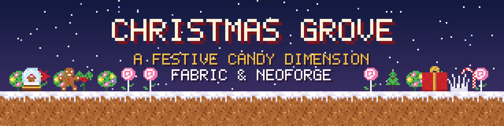
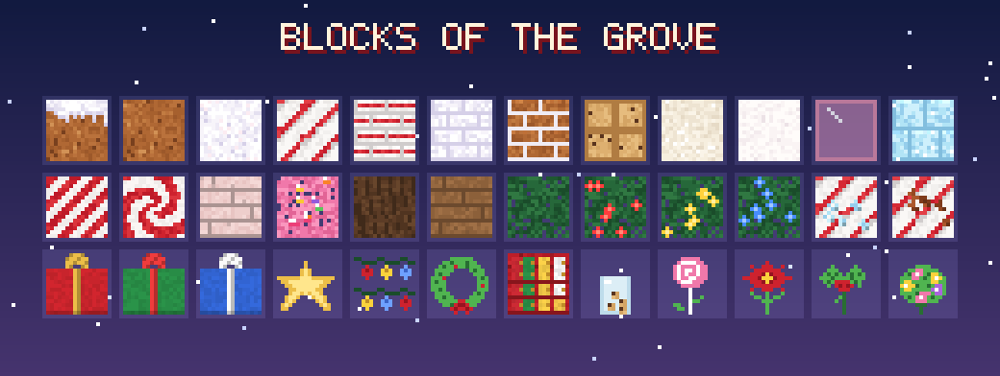
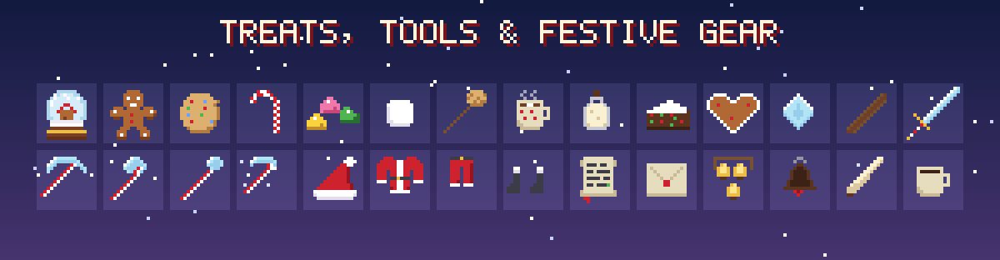

# CurseForge (and Modrinth) upload kit

Everything to paste into the project page, in the order the forms ask for it. The description
below is plain Markdown; on CurseForge pick the **Markdown** editor when you paste it. Image
links point at the GitHub repo, which works once it is public. Until then, upload the images
in `docs/showcase/` to the project's Images tab and swap in those URLs.

## Project settings

| Field | Value |
| --- | --- |
| Name | Christmas Grove |
| Slug | `christmas-grove` (free on Modrinth as of Nov 17; check CurseForge when you create it) |
| Summary (CurseForge, max 250) | Shake a Snow Globe and visit a candy-and-cookie Christmas dimension: five festive biomes, Santa's Workshop, a sleigh that drops presents, reindeer, elves, Krampus and more. |
| Summary (Modrinth, max 256) | Same as above |
| Main category | World Gen → Dimensions |
| Extra categories | Biomes, Mobs, Structures, Food, Adventure and RPG, Armor, Tools, and Weapons |
| Modrinth tags | adventure, decoration, food, mobs, worldgen, equipment |
| Loaders | Fabric (needs Fabric API), NeoForge |
| Game versions | 1.21.1 (26.3 to follow) |
| Environment | Client and server (required on both) |
| License | Custom: MIT for code, All Rights Reserved for assets (see LICENSE) |
| Source | https://github.com/marso006/christmas-grove (make the repo public first, or leave blank) |
| Issues | https://github.com/marso006/christmas-grove/issues |
| Icon | `docs/showcase/icon.png` (400x400) |
| Gallery | `banner.png`, `feature_blocks.png`, `feature_items.png`, plus your screenshots (see SHOTLIST.md) |

## Files

Upload one jar per loader, and mark each with its loader and game version:

- `christmas-grove-fabric-1.21.1-<version>.jar`: Fabric, 1.21.1, depends on **Fabric API** (add it as a required dependency on both sites)
- `christmas-grove-neoforge-1.21.1-<version>.jar`: NeoForge, 1.21.1

Release type: **Beta** for the first public build, **Release** once it has had a few days of player feedback.
Paste the matching section of `CHANGELOG.md` as the file changelog.

---

## Description (paste from here down)

**Shake a Snow Globe and step into a world made of candy.** Christmas Grove adds a whole Christmas
dimension to Minecraft: frosted gingerbread hills, candy-cane forests, glowing Christmas trees, a
hot-chocolate sea, and a cast of festive creatures, from runaway Gingerbread Men to Santa himself.
And if you have been naughty... Krampus.

### ❄️ Getting there

Craft a **Snow Globe** (glass dome, a cookie inside, a snowy wooden base) and use it. You arrive in
the Christmas Grove; use it again to go home. No portal to build, no lighter to lose.

### 🎄 Five festive biomes

- **Gingerbread Grove**: candy-cane trees with gumdrop leaves, gumdrop bushes, lollipop flowers
- **Festive Fir Forest**: real Christmas trees that grow with glowing red, gold and blue lights and a star on top, with presents scattered underneath
- **Frosted Flats**: open frosting plains with giant candy canes towering over them
- **Peppermint Peaks**: red-and-white striped mountains with iced summits
- **Cocoa Sea**: an ocean of hot chocolate with bouncy marshmallow islands floating on it

### 🎅 Santa, elves and friends

- **Santa Claus** lives in his Workshop. Visit him once a day for a present, and twice on Christmas Day
- **Santa's Sleigh** sometimes flies across the sky, pulled by four reindeer, and drops presents that float down on little parachutes. Write a **Letter to Santa** to call him yourself
- **Elves** trade decorations, presents, saplings and sleigh bells
- **Reindeer** can be tamed and ridden. Give one **Sleigh Bells** and it glides through the air
- **Peppermint Pups** are tamed with candy canes and stay loyal forever
- **Gingerbread Men** run away from you. Catch one!

### 😈 Naughty or nice?

Santa keeps a list, and so does the mod. Hurting friendly creatures (or trying to hit Santa) puts
you on the naughty list; trading, adopting pups, giving presents and protecting the Grove makes you
nice. Nice players get extra presents. Naughty players get coal, and if they keep it up, **Krampus**
comes for them: a boss with chains that drag you in and an army of evil snowmen. Defeat him to
wipe your record clean, or ring a **Krampus Bell** if you want the fight.

### 🏠 Places to explore

- **Gingerbread Houses** with an elf at home and a stocked kitchen
- **Santa's Workshop**: a great hall full of workbenches, presents and a Christmas tree
- **Candy Cane Outposts** guarded by nutcracker-style Cookie Soldiers
- **Snowman Camps** where the Evil Snowmen hoard their loot

### 🎁 Presents for real

Gift Boxes are containers: put up to nine items inside, carry the wrapped box to a friend, and
let them unwrap it. Presents you find in the world are surprises with random loot. Hang an **Advent
Calendar** on your wall, which opens one little door per real-world day from December 1st to 25th.

### 🍪 Treats, tools and festive gear

- Hot cocoa, eggnog, gingerbread cookies, sugar cookies, fruitcake, gumdrops, candy canes and campfire-roasted marshmallows
- **Sugar Crystal tools** with candy-cane handles, and the **Candy Cane Sword**
- The **Santa Suit**: hat (a real 3D drooping hat with a pompom), coat, trousers and boots. Wear it and you never freeze in powder snow
- 75 new blocks and over 35 new items: two full wood sets, peppermint, icing, gingerbread and cookie building sets, candy glass, festive lights, wreaths, Christmas stars and more

### ℹ️ Good to know

- **Loaders:** Fabric (requires Fabric API) and NeoForge, Minecraft 1.21.1. A 26.3 version is on the way
- **Multiplayer:** works on servers. Install on both the server and every client
- **Existing worlds:** the dimension is added to old worlds as well as new ones
- **Modpacks:** you may include this mod in modpacks

### 📜 License

Code is MIT. Textures, models, structures and other assets are All Rights Reserved: please don't
re-upload them. Santa Claus, Krampus, elves and gingerbread men come from public-domain folklore;
everything in the mod is original.

*Merry Christmas, and happy exploring!*
