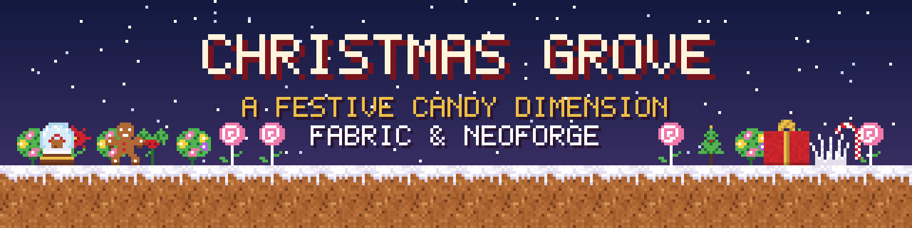

## Shake a Snow Globe. Step into Christmas.

**Christmas Grove** adds a whole Christmas dimension to Minecraft: frosted gingerbread hills,
candy-cane forests, Christmas trees that glow with fairy lights, a hot-chocolate sea, and a village
where Santa and his elves are busy getting ready for the big night. Look up, and you might see his
sleigh fly over, dropping presents on little parachutes.

Just don't be naughty. Krampus is watching.

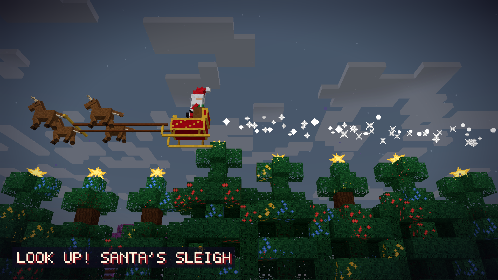

---

## ❄️ Getting there

Craft a **Snow Globe** (a glass dome with a cookie inside, on a wooden and snowy base) and use it.
You're taken straight to the Christmas Grove, and the globe steers you away from the Cocoa Sea so
you land on dry ground. Use it again to go home. There's no portal to build and nothing to light.

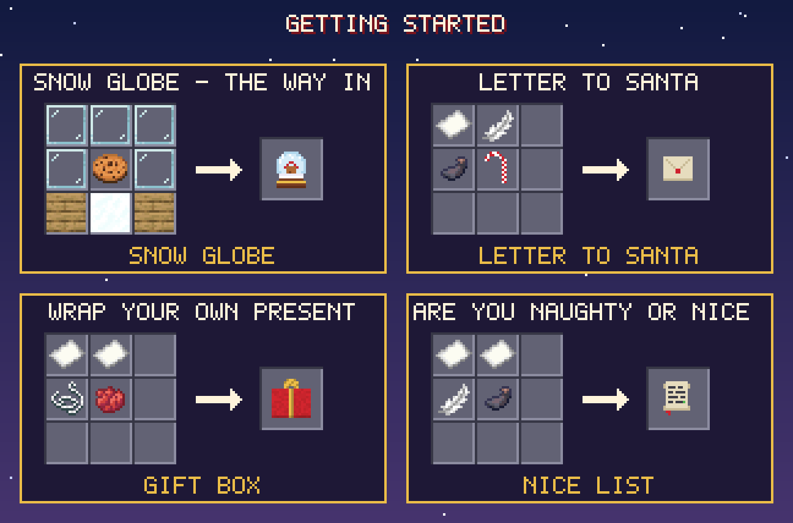

---

## 🎄 A world made of Christmas

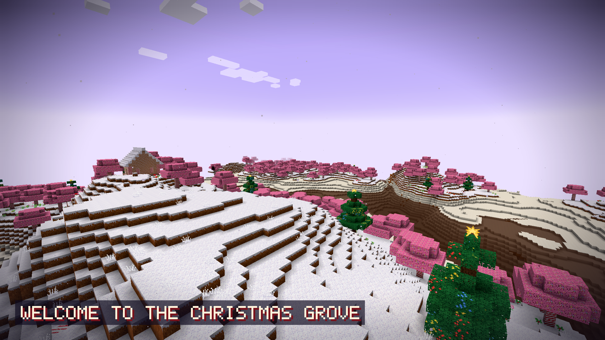

Five biomes, each with its own sky:

- **Gingerbread Grove**: candy-cane trees topped with gumdrops, gumdrop bushes you can harvest, lollipop flowers and poinsettias
- **Festive Fir Forest**: real Christmas trees that grow with red, gold and blue lights and a star on top, with presents scattered underneath
- **Frosted Flats**: open frosting plains with giant candy canes standing in the snow
- **Peppermint Peaks**: striped mountains under a lilac sky, with iced summits
- **Cocoa Sea**: a hot-chocolate ocean with bouncy marshmallow islands floating on it

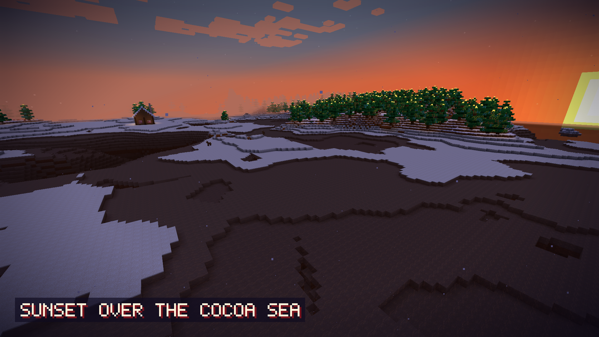

Every Christmas tree you grow from a sapling comes decorated too, star included.

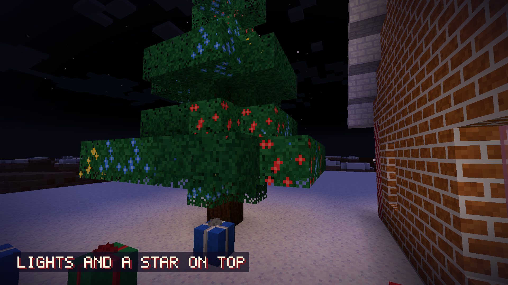

---

## 🏠 Places to discover

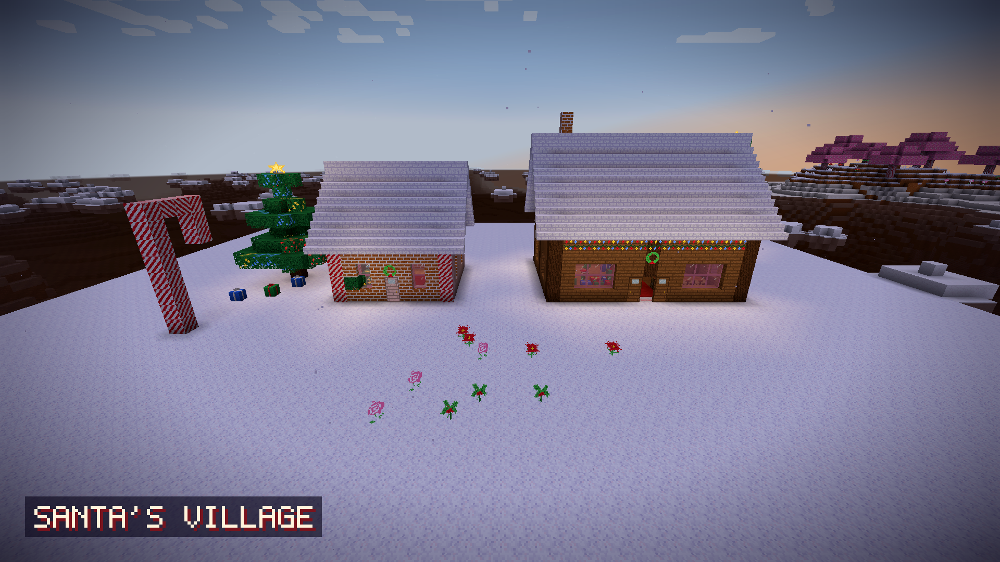

- **Santa's Workshop**: a great hall with a fireplace, workbenches, piles of presents, a Christmas tree, and Santa himself with his elves
- **Gingerbread Houses**: cosy cottages with candy-cane corners, an elf at home and a kitchen to raid
- **Candy Cane Outposts**: peppermint towers guarded by nutcracker-style Cookie Soldiers, with the best loot at the top
- **Snowman Camps**: where the Evil Snowmen gather around their campfire and hoard what they've stolen

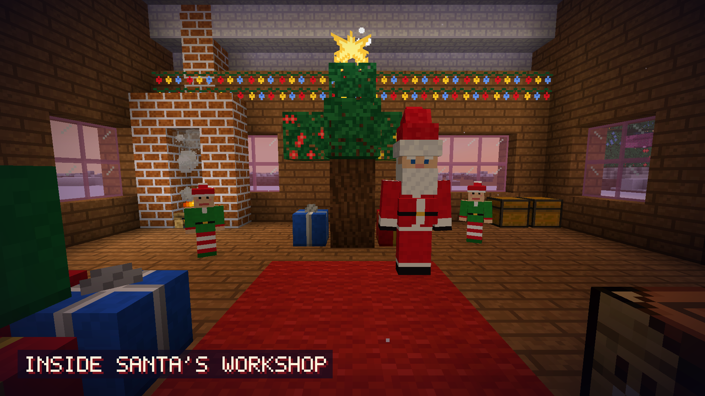

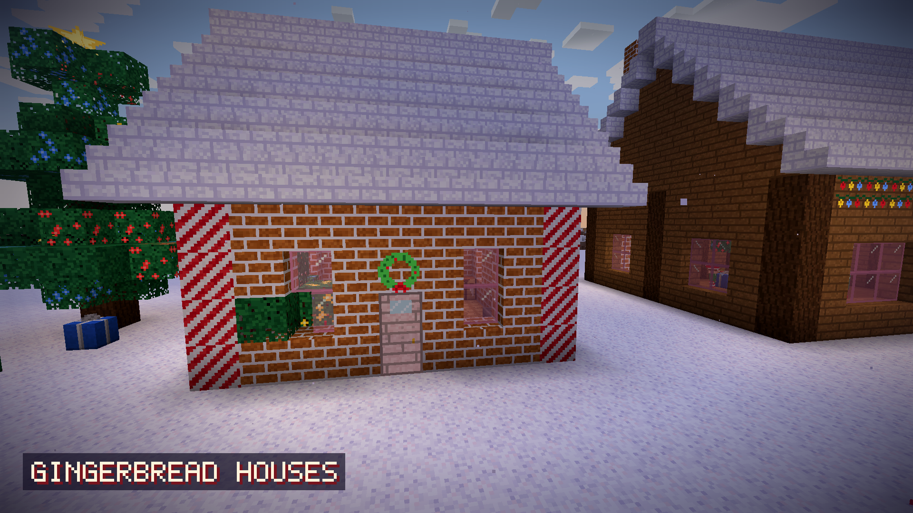

---

## 🎅 Santa, his sleigh, and the locals

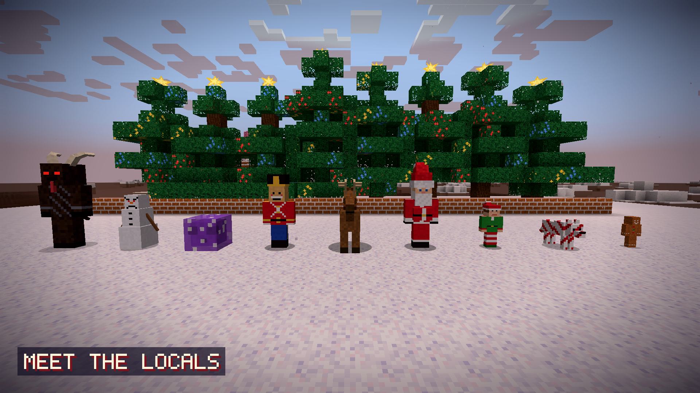

- **Santa Claus** lives in his Workshop. Talk to him once a day for a wrapped present, and on Christmas (December 24th to 26th, real date) he gives two
- **Santa's Sleigh** flies across the sky now and then, more often at night, and in the Overworld on December nights. Presents float down on candy-striped parachutes and land as gifts you can unwrap. Want him now? Send a **Letter to Santa**
- **Elves** trade festive lights, wreaths, presents, saplings, sleigh bells and more for Sugar Crystals and emeralds
- **Reindeer** can be tamed and ridden like horses. Fit them with **Sleigh Bells** and they glide gently through the air, jingling as they go
- **Peppermint Pups** are tamed with candy canes and stay by your side
- **Gingerbread Men** run away the moment they see you. Catch one with an empty hand!

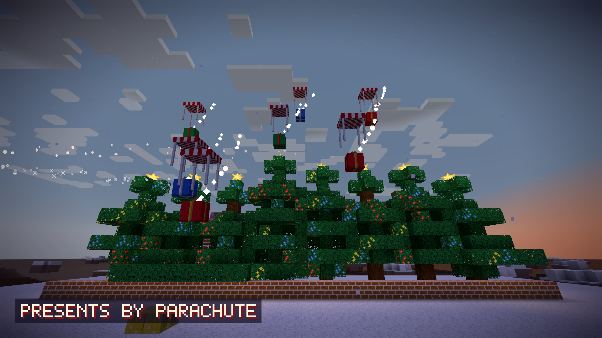

---

## 😈 Naughty or nice?

Santa keeps a list, and so does Christmas Grove.

- **Naughty:** hurting Gingerbread Men, reindeer, pups or elves, or trying to hit Santa
- **Nice:** trading with elves, adopting pups, giving presents to friends, and protecting the Grove from its monsters

Nice players get extra presents. Naughty players get **coal**: from Santa, and dropped on them by
the sleigh. Read a **Nice List** to see where you stand.

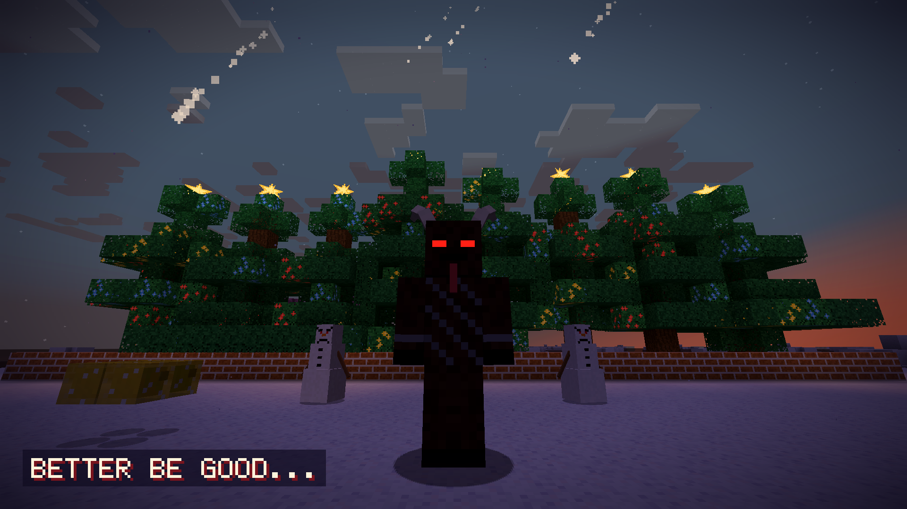

Keep being naughty and **Krampus** comes for you: a towering boss with glowing eyes, chains that
drag you in, and an army of Evil Snowmen he calls when he's hurt. Beat him and Santa wipes your
name off the naughty list. Brave enough to fight him on purpose? Ring a **Krampus Bell**.

The Grove has other dangers too: **Cookie Soldiers** with candy-cane swords, **Gumdrop Blobs** that
split into smaller ones when defeated, and **Evil Snowmen** that throw snowballs that sting and slow you down.

---

## 🎁 Real presents

- **Gift wrapping:** place a Gift Box, sneak and use it, and put up to nine items inside. Break it to carry the wrapped present to a friend, who unwraps it to see what you gave them. Giving presents makes you nicer!
- **Surprise presents:** boxes you find in the world, or get from Santa and the sleigh, hold random loot, sometimes very good loot
- **Advent Calendar:** hang it on your wall and open one little door every real-world day from December 1st to 25th, with the best gifts saved for the last two days
- **Cookie Jar:** a little glass jar for your cookies (or anything else)

---

## 🍪 Treats, tools and the Santa Suit

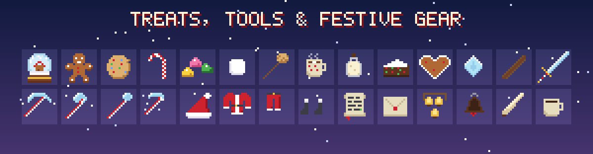

- **Food:** hot cocoa (speed and haste), eggnog (regeneration), gingerbread and sugar cookies, fruitcake, gumdrops, candy canes, campfire-roasted marshmallows, and the rare **Gingerbread Heart** (extra hearts)
- **Sugar Crystal tools** with candy-cane handles, and the **Candy Cane Sword**
- **The Santa Suit:** hat, coat, trousers and boots. The hat is a proper 3D Santa hat with a pompom, and wearing the suit means you never freeze in powder snow

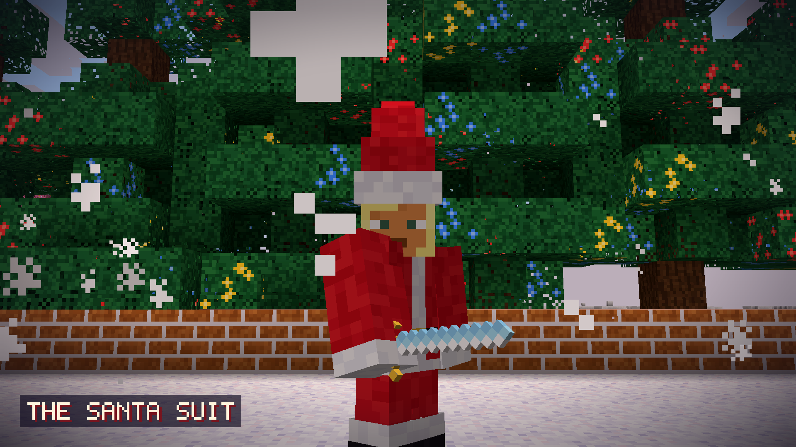

---

## 🧱 75 new blocks

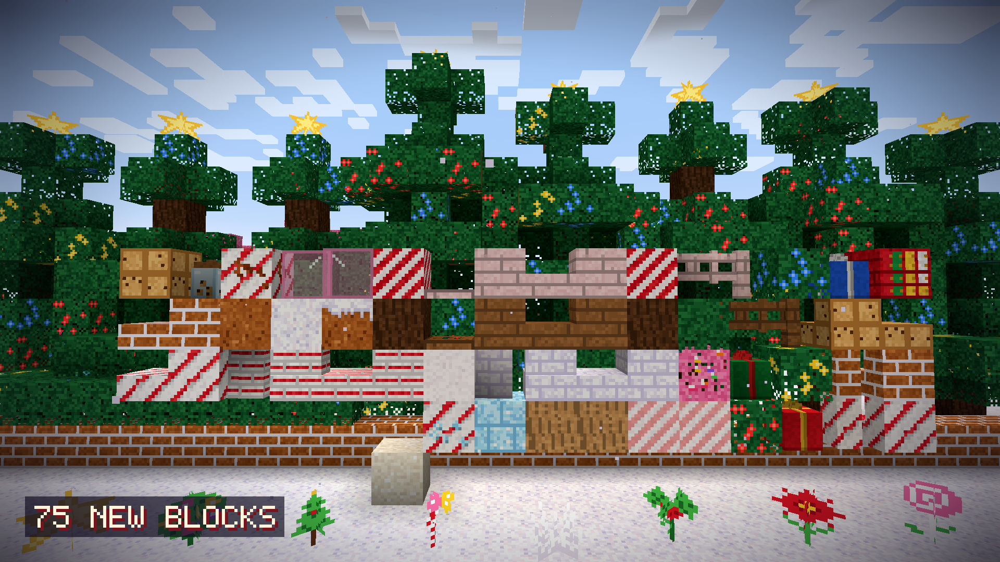

Two full wood sets (Candy Cane and Festive Fir, with doors, fences and everything else); building
sets of peppermint, icing, gingerbread and cookie tiles; candy glass; sugar sand; bouncy marshmallow
that saves you from fall damage; festive lights that glow; wreaths; Christmas stars; gift boxes;
the Advent Calendar and the Cookie Jar.

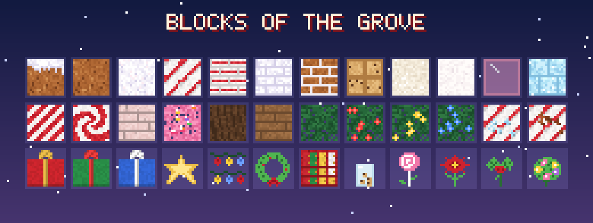

---

## 📖 More recipes

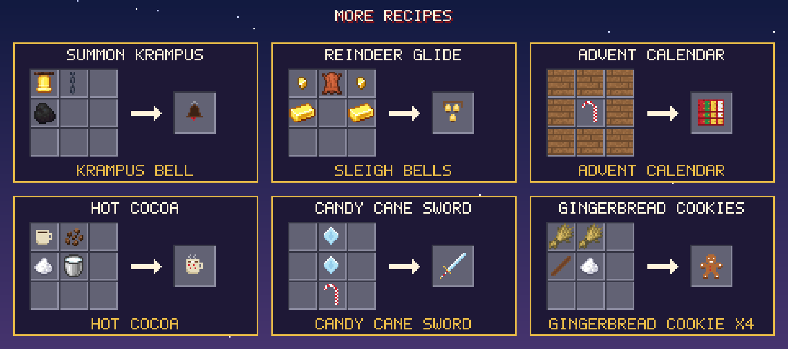

Everything else (building blocks, tools, the Santa Suit and food) shows up in your recipe book as
soon as you pick up the ingredients.

---

## ❓ FAQ

**Where is Santa?** In Santa's Workshop, which generates in the Festive Fir Forest. With cheats on,
`/locate structure christmas_grove:santas_workshop` finds the nearest one.

**How do I tame a reindeer?** Just like a horse: keep riding it until it calms down. Feeding it
sugar or apples helps. Then saddle it and give it Sleigh Bells.

**Krampus won't come.** He doesn't visit on Peaceful difficulty.

**Why won't the Advent Calendar open?** It follows the real-world date and only opens from
December 1st to 25th, one door per day.

**Can I add it to an existing world?** Yes. The dimension is available in old worlds too, and the
Snow Globe works the same.

**Does it work in multiplayer?** Yes. Install it on the server and on every player's client.

**Can I use it in my modpack?** Yes, go ahead.

---

## ⚙️ Requirements

- **Minecraft 1.21.1**, with **Fabric** (plus [Fabric API](https://www.curseforge.com/minecraft/mc-mods/fabric-api)) or **NeoForge**
- A version for **Minecraft 26.3** is on the way

---

## 📜 License and credits

The code is MIT-licensed. Textures, models, structures and other assets are All Rights Reserved:
please don't re-upload them. Santa Claus, Krampus, elves and gingerbread men come from public-domain
folklore, and everything in the mod is original work.

*Merry Christmas, and happy exploring!* 🎄
